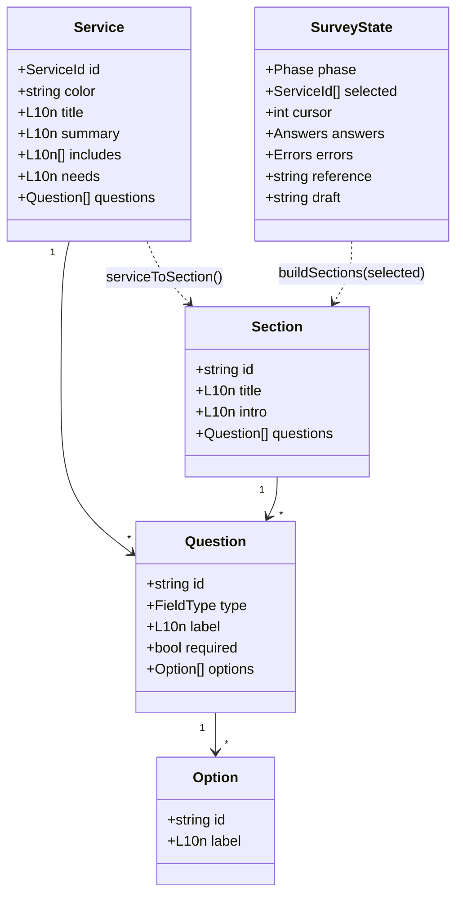
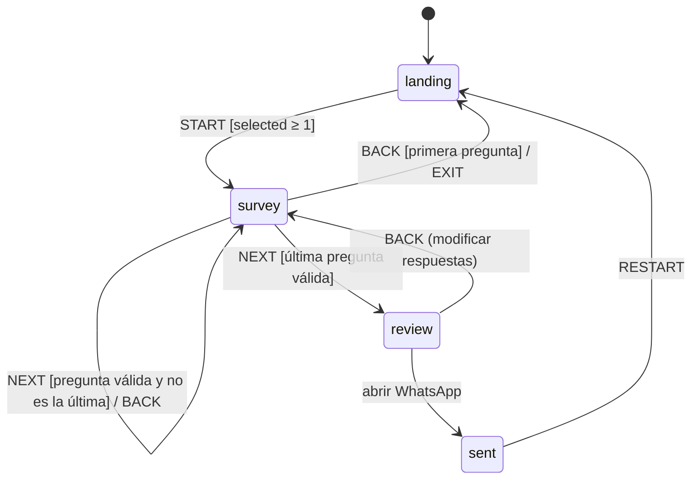
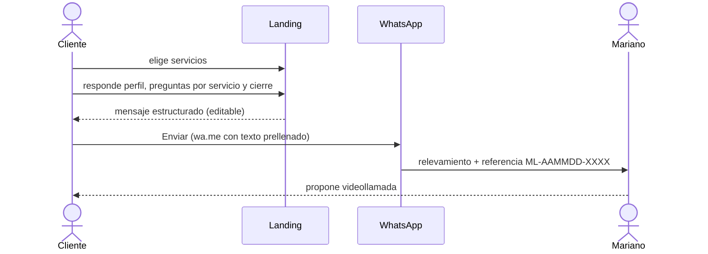

# Arquitectura — Landing de relevamiento

## Decisiones

| Tema | Decisión | Motivo |
|---|---|---|
| Render | Next.js 16 con `output: 'export'` (100 % estático) | Sin servidor ni costos variables. Carga rápida desde el CDN de Vercel |
| Persistencia | **Sin base de datos** | El registro vive en WhatsApp. El estado del formulario se guarda en `sessionStorage` para no perderlo al cambiar de idioma |
| Canal | Enlace `wa.me/<número>?text=` | Funciona en móvil y escritorio sin la API de WhatsApp Business |
| Idiomas | Rutas `/es/`, `/pt/`, `/en/`; `/` detecta el idioma del navegador | SEO con `hreflang`. Las respuestas guardan **ids**, no textos, y por eso sobreviven al cambio de idioma |
| Diseño | Identidad de la v0 (fondo oscuro con brillos magenta/violeta/cian, malla de puntos y grano; Saira + IBM Plex Sans; logo 3D por CSS), sección "Tecnología pensada desde su negocio" con diagrama de arquitectura (se dibuja al entrar en pantalla y lleva a cada servicio), y láminas ilustradas con detalle al pasar el cursor | Comunica los servicios a simple vista, sin WebGL ni imágenes pesadas |
| Tipografía | Saira + IBM Plex Sans servidas desde el propio sitio (`@fontsource`) | Sin dependencia de Google Fonts y con mejor privacidad |
| IA | Fuera de la v1 | Ver "Evolución" |

## MVC

```
src/
├─ config/site.ts            Datos de contacto (único archivo a editar)
├─ model/                    MODELO: dominio puro, sin React
│  ├─ types.ts               Locale, Service, Section, Question, Answers
│  ├─ catalog.ts             6 servicios + perfil + cierre (preguntas trilingües)
│  ├─ i18n.ts                Textos de interfaz por idioma
│  ├─ flow.ts                Aplana las secciones en una lista de preguntas (una por vez)
│  ├─ offer.ts               Oferta del relevamiento técnico: precio por bloque, costo total
│  ├─ validation.ts          Reglas de obligatoriedad (por pregunta) y avance de datos clave
│  └─ message.ts             buildMessage · buildWhatsAppUrl · createReference
├─ controller/               CONTROLADOR
│  ├─ surveyReducer.ts       Máquina de estados pura (testeada)
│  └─ useSurvey.ts           Hook: reducer + sessionStorage + mensaje derivado
├─ view/                     VISTA: componentes sin lógica de negocio
│  ├─ App.tsx                Elige landing o relevamiento según la fase
│  ├─ components/            Layout, Sections, Logo, Icons
│  └─ survey/                SurveyView · Chat (banda + vista previa + respuesta) · Composer (pregunta y chips o texto) · Preview
├─ app/                      Rutas Next (sólo composición)
└─ (raíz)
   ├─ scripts/               Endurecimiento posterior al build y verificador (ver SEGURIDAD.md)
   ├─ .github/               CI, verificación programada del sitio publicado y Dependabot
   └─ vercel.json            Encabezados de seguridad de producción

La arquitectura futura (Cloudflare, Frappe/CRM) está en INTEGRACIONES.md.
```

### Diagrama de clases (modelo)



### Máquina de estados



### Secuencia de sistema (caja negra)



## Agregar o modificar preguntas

1. Editar `src/model/catalog.ts`. Cada texto lleva `t('es', 'pt', 'en')`.
2. Tipos disponibles: `text`, `textarea`, `single`, `multi`. Con `required: true` el campo bloquea el avance.
3. `npm test` comprueba que todo esté traducido y que los ids no se repitan.

## Evolución sugerida

- **v1.1:** métricas con Vercel Analytics (visitas, servicios más elegidos y clics en "Enviar").
- **v2 (IA opcional):** una función serverless que reciba los textos libres y devuelva un resumen ejecutivo para anteponer al mensaje. Habría que quitar `output: 'export'` y agregar `app/api/resumen/route.ts`. El cliente revisa el resultado antes de enviarlo.
- **v2 (registro de consultas):** si hace falta un histórico, alcanza con una tabla `solicitud(id, referencia, fecha, idioma, servicios[], respuestas jsonb)` en Vercel Postgres o Neon.
