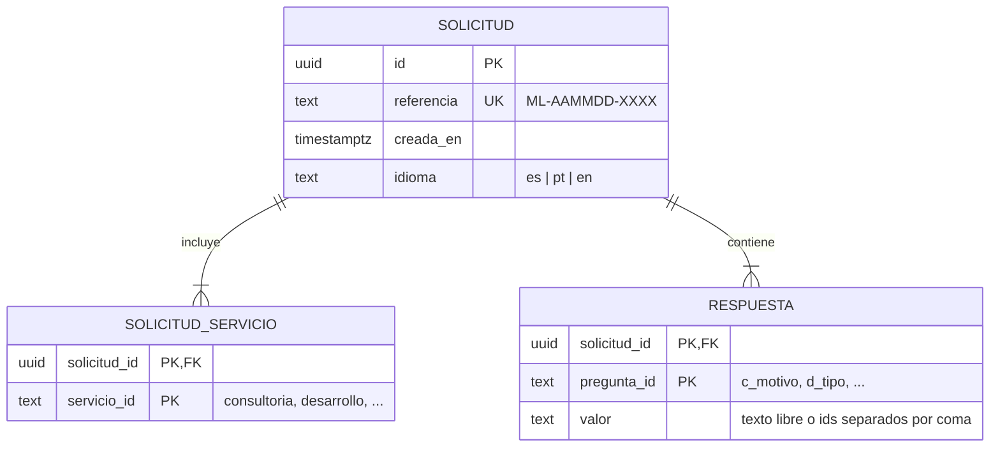

# Especificación — Landing de relevamiento (Mariano Lemos Barbaro)

Documento funcional y de diseño, escrito sobre el código existente al 2026-11-20 y sobre la tarjeta ejecutiva (el QR del frente apuntará a este sitio). Complementa a [ARQUITECTURA.md](ARQUITECTURA.md), que explica las decisiones técnicas y el MVC; acá no se repiten.

Los datos de contacto reales no se copian en este documento: viven en `src/config/site.ts`, que es la única fuente.

## 1. Objetivo

Que un cliente potencial cuente **qué necesita** con sus palabras, sin tecnicismos, y que esa información llegue a Mariano como **un único mensaje de WhatsApp ya ordenado**, listo para coordinar una videollamada.

El sitio no es una tienda ni un portal: es un **embudo corto** entre la tarjeta (o un enlace) y la conversación por WhatsApp.

## 2. Contexto y marca

La tarjeta presenta a Mariano como *Arquitecto & Consultor Senior IT* y ordena la oferta en **seis pilares**. El sitio usa exactamente esos mismos pilares como servicios, con los mismos nombres:

| Pilar de la tarjeta | Servicio en el código (`ServiceId`) | Preguntas propias |
|---|---|---|
| Consultoría & Gestión | `consultoria` | 4 |
| Gestión & Integraciones | `gestion` | 4 |
| Infraestructura & Redes | `infraestructura` | 4 |
| Desarrollo de Software | `desarrollo` | 5 |
| Inteligencia Artificial | `ia` | 4 |
| Soporte & Hardware 24/7 | `soporte` | 4 |

**Soporte 24/7** es para emergencias, reparación y mantenimiento de equipos, en remoto o presencial. Cualquier otra asesoría pasa por el **relevamiento técnico, que se paga por bloques de 10 minutos** (ver sección 3).

Identidad compartida con la tarjeta (definida en `src/styles/globals.css`): fondo `#05070c`, acentos cian `#00d8f5`, magenta `#ff3ea5` y violeta `#8a3cff`, tipografías Saira (títulos) e IBM Plex Sans (texto), monograma "ML" plateado/cian.

## 3. Alcance

**Dentro**
- Landing en `es`, `pt` y `en` (`/es/`, `/pt/`, `/en/`); `/` detecta el idioma del navegador.
- Selección de uno o varios servicios, relevamiento guiado, revisión editable y envío por WhatsApp.
- Atajo de **Emergencia 24/7**: botón flotante que abre WhatsApp con un mensaje breve (nombre, lugar, qué pasa y si es remoto o presencial), sin pasar por el relevamiento.
- **Oferta del relevamiento técnico**: USD 9 **por cada 10 minutos de reunión** (no por reunión), con el precio original (USD 12, −25 %) tachado. El total depende de cuánto dure: 30 min = USD 27, 1 h = USD 54, 3 h = USD 162 (18 bloques; antes USD 216). Se muestra en el inicio y en la sección *Relevamiento técnico*, con esos tres ejemplos calculados por `meetingCost()`, y queda registrada en el mensaje cuando el pedido incluye algo distinto de Soporte. Precio por bloque, duración del bloque y moneda salen de `site.consulta`. Un tramo incompleto cuenta como un bloque más (regla del cálculo; los ejemplos mostrados son múltiplos exactos). Sin fecha de fin: no se muestra ninguna cuenta regresiva.
- Sitio 100 % estático (`output: 'export'`), publicado en Vercel.

**Fuera (por decisión)**
- Base de datos, cuentas de usuario, panel de administración. Tampoco hay cobro ni agenda en el sitio: la consulta se coordina por WhatsApp.
- API de WhatsApp Business: se usa el enlace `wa.me/<número>?text=`.
- IA generando resúmenes (ver "Evolución" en ARQUITECTURA.md).

## 4. Actores y escenarios

| Actor | Qué quiere | Cómo lo resuelve el sitio |
|---|---|---|
| Cliente que consulta | Explicar su necesidad sin saber de tecnología | Elige servicios y responde preguntas en lenguaje de negocio |
| Cliente con urgencia | Ayuda técnica ya, en remoto o presencial | Botón **Emergencia 24/7** → WhatsApp directo |
| Cliente que busca asesoría | Una respuesta puntual sin compromiso grande | Oferta de **relevamiento técnico a USD 9 cada 10 min**; la conversación guiada prepara la reunión |
| Mariano | Llegar a la videollamada con contexto y saber de dónde vino | Recibe un mensaje estructurado con referencia `ML-AAMMDD-XXXX`, versión del formulario y origen |

## 5. Flujo del usuario

1. **Landing**: propuesta con el aviso del relevamiento técnico (USD 9 cada 10 min), diagrama "Tecnología pensada desde su negocio", servicios (con detalle de lo que incluyen y qué conviene contar), la sección de la oferta con el costo total según la duración, y el enfoque de trabajo. Se marcan uno o más servicios y se pulsa continuar. El detalle de cada servicio se abre al pasar el cursor o al enfocar con teclado en escritorio (con un contorno degradado del color del servicio que aparece suave y el contenido entrando escalonado), y con el botón *Ver detalles* en táctil.
2. **Relevamiento como conversación guiada**, una pregunta por vez, con barra de progreso por secciones:
   1. *Su actividad*: solo tres datos, todos obligatorios y de respuesta rápida: a qué se dedica, cuántas personas trabajan y cuántas sucursales u oficinas tiene.
   2. Una sección **por cada servicio elegido**, en el orden del catálogo: la información crítica (problema, objetivo, qué pasa).
   3. *Expectativas y reunión* (6 preguntas: resultado esperado, plazo, presupuesto, decisor, franja y plataforma de la videollamada).
   4. *Datos de contacto*, al final: nombre y apellido (obligatorio), empresa, ciudad y país, correo. El número de WhatsApp llega solo con el mensaje.
3. **Revisión**: se muestra el mensaje final; el cliente puede editarlo a mano o volver a corregir respuestas.
4. **Envío**: abre WhatsApp con el texto prellenado. El cliente pulsa *Enviar* en su propia app.
5. **Enviado**: pantalla de cierre con opción de empezar de nuevo.

**La conversación.** Una sola tarjeta, de arriba hacia abajo (`Chat.tsx`):
1. **Banda de la sección o servicio en curso**: ícono, nombre grande, "Sección 2 de 5 · Pregunta 3 de 5", puntos de avance de la sección y el color propio del servicio. Cambia con una animación al pasar a otra sección.
2. **Vista previa del mensaje** con el formato de WhatsApp (`Preview.tsx`), siempre visible y con scroll propio. Los datos críticos que faltan aparecen como *pendiente*; la pregunta que se está respondiendo se resalta con su renglón (si es opcional, como *opcional*) y la vista previa se desplaza sola hasta ella. Un indicador muestra cuántos datos clave van completos ("Datos clave: 3 de 8"). Es el mismo constructor que arma el mensaje real, por eso no puede diferir de lo que se envía. El nombre pasa al saludo apenas se escribe.
3. **Pregunta y zona de respuesta** (`Composer.tsx`), abajo, como el área de escribir de un chat: la pregunta en una burbuja (con su etiqueta *Obligatorio* u *Opcional*) y debajo la forma de contestar.

Cómo se responde:
- **Opción única** (chips): al tocar una, queda marcada y a los 320 ms pasa sola a la siguiente. Si ya estaba respondida, aparece *Siguiente*.
- **Opción múltiple** (chips): se marcan varias y se sigue con *Siguiente*.
- **Texto**: campo con botón de enviar. En el texto largo, con teclado físico, Enter envía y Mayús+Enter agrega una línea; en el celular Enter agrega una línea y se envía con el botón.
- **Omitir**: las opcionales sin responder se saltan con *Omitir*. Las obligatorias sin responder no avanzan y muestran el aviso junto a la zona de respuesta.
- **Atrás** vuelve a la pregunta anterior conservando lo respondido; en la primera vuelve al inicio. Los pasos ya vistos de la barra de progreso se pueden reabrir; los siguientes no (saltar adelante dejaría obligatorias sin responder).

Transición entre preguntas (solo `opacity` y `transform`): la pregunta anterior se desvanece y sube (170 ms), aparece un indicador de "escribiendo…" (380 ms) y entra la nueva, con sus opciones escalonadas. Al volver atrás no se simula que se escribe. Con "reducir movimiento" el cambio es inmediato y sin indicador. Mientras sale la anterior la zona de respuesta no admite toques (`inert`), así que no se puede avanzar dos veces.

Foco: al llegar una pregunta, con mouse el foco va al campo de texto; en táctil va a la pregunta (para no abrir el teclado sin que se pida) y los lectores de pantalla la leen.

Reglas de formulario (en `catalog.ts` y `validation.ts`):
- Cada pregunta obligatoria bloquea el avance mientras no esté respondida. Con un servicio distinto de Soporte hay **8 obligatorios** en todo el recorrido: 3 de actividad, 2 del servicio, 2 de expectativas y 1 de contacto. Soporte exige 3 propios, porque la modalidad (remoto o presencial) define cómo se atiende.
- Una respuesta de opción cuyo id ya no existe en el catálogo no cuenta como respondida: el mensaje la omitiría y no puede darse por completo un dato que no se envía.
- Cuatro tipos de campo: `text` (hasta 120 caracteres), `textarea` (hasta 600), `single` y `multi`. Los campos de contacto declaran `autocomplete` y teclado móvil adecuados.
- Las respuestas de opción guardan **ids**, no textos, por eso sobreviven al cambio de idioma.
- Un recorrido mínimo son 17 preguntas (17 pantallas de la conversación); con los seis servicios, 38.

## 6. Mensaje de WhatsApp

Lo construye `buildLines` (función pura): de las mismas líneas salen el texto que se envía (`buildMessage`) y la vista previa. Ejemplo real generado con el código, para un cliente que eligió *Desarrollo de Software* y llegó desde el QR de la tarjeta:

```text
Hola Mariano, soy Ana Pérez. Quiero hacer una consulta.

*RELEVAMIENTO INICIAL* · Ref. ML-261120-DDDD
*Servicios de interés:* Desarrollo de Software
*Consulta:* USD 9 cada 10 min de relevamiento técnico (oferta; precio original USD 12)

*1. Su actividad*
• A qué se dedica la organización: Comercio minorista de ferretería
• Cuántas personas trabajan en la organización: 2 a 10
• Cuántas sucursales u oficinas tiene: 2 o 3

*2. Desarrollo de Software*
• Qué está buscando: Un sistema nuevo desde cero
• Qué problema debería resolver:
  Llevamos stock y ventas en planillas y se pisan los datos.

*3. Expectativas y reunión*
• Si todo sale bien, qué habría cambiado dentro de 6 meses:
  Tener el stock al día sin planillas.
• Para cuándo lo necesita: En las próximas semanas

*4. Datos de contacto*
• Nombre y apellido: Ana Pérez
• Empresa u organización: Ferretería Norte
• Ciudad y país: Posadas, Argentina
• Correo electrónico: ana@ejemplo.com

Quedo a la espera para coordinar la videollamada.
_Enviado desde tu-dominio.com · ES · v3 · origen: tarjeta_
```

- Solo se incluyen las preguntas respondidas.
- El mensaje sale en el idioma que el cliente está usando.
- La línea **Consulta** registra la oferta que el cliente vio (importe por bloque, duración del bloque y precio original). Aparece cuando el pedido incluye algún servicio distinto de Soporte.
- **Trazabilidad** en el pie: dominio, idioma, versión del formulario (`v3`, `SURVEY_VERSION`) y, si vino de un enlace con `?o=...`, el origen. La referencia `ML-AAMMDD-XXXX` identifica la consulta.
- Si la URL supera 6000 caracteres se muestra un aviso (`SAFE_URL_LENGTH`), porque algunos navegadores móviles truncan enlaces largos. Con un solo servicio y todos los textos al máximo se queda dentro del límite; con los seis servicios y todos los textos al máximo, no.

## 7. Datos

**Decisión: sin base de datos.** El único registro de la consulta es la conversación de WhatsApp.

- El estado del relevamiento se guarda en `sessionStorage` (clave `ml-relevamiento-v3`; guarda las respuestas y la pregunta en curso) para no perder respuestas al cambiar de idioma o recargar. Se descarta al cerrar la pestaña, y `sanitize()` valida tipos, ids, largos y la referencia de lo recuperado (ver [SEGURIDAD.md](SEGURIDAD.md)). Se escribe 250 ms después de la última tecla y siempre al ocultar la página o cambiar de idioma.
- **Cambio de idioma a mitad del relevamiento:** cada idioma es una página estática cuyo HTML arranca en la landing. Un script en `<head>` (`src/controller/resume.ts`) marca `<html data-resume>` antes del primer pintado si hay un relevamiento en curso; el CSS oculta la landing y `useSurvey` quita la marca al restaurar la pregunta en curso. Si la hidratación tarda más de 5 s, se muestra la landing igual. En `next dev` el Strict Mode borra esa marca, así que el efecto solo se aprecia con el build de producción (`npm run build` y `npm start`).
- **Origen de la visita:** un enlace con `?o=tarjeta` (por ejemplo, el QR de la tarjeta) guarda ese origen en el estado, sobrevive al cambio de idioma y viaja en el mensaje. Solo admite letras, números, guion y guion bajo (hasta 24); el primer origen gana. La redirección de `/` conserva la consulta.
- El sitio declara en pantalla que no guarda datos; esa frase debe revisarse si se agrega analítica (ver pendientes).

**Si algún día hace falta histórico**, el modelo relacional mínimo y normalizado alcanza con tres tablas, porque el catálogo (servicios y preguntas) sigue en el código y las respuestas ya guardan ids:



No está implementado. La alternativa de una sola tabla con `jsonb` está en ARQUITECTURA.md.

## 8. Lineamientos de diseño y buenas prácticas

| Lineamiento | Estado en el código | Evidencia |
|---|---|---|
| MVC separado, el modelo sin React | Cumplido | `src/model`, `src/controller`, `src/view` |
| Lógica de negocio con pruebas | Cumplido: 157 pruebas pasan, incluido el recorrido de las 63 combinaciones de servicios, la conversación operada en un DOM simulado y las de seguridad | `tests/`, ver [QA.md](QA.md) |
| Tipado estricto | Cumplido: `tsc --noEmit` sin errores | `npm run lint` |
| Móvil primero y responsivo | Implementado, sin auditar en dispositivos | puntos de corte 640 px y 900 px |
| Foco visible y navegación por teclado | Implementado; los chips son botones con `aria-pressed`, el foco acompaña a cada pregunta y la región con scroll de la vista previa es enfocable | `:focus-visible` global, `Composer.tsx`, `Preview.tsx` |
| Lo que escribe el cliente no inyecta HTML | Cumplido: la vista previa arma elementos de React, sin HTML en crudo; hay prueba de escape | `tests/preview.test.ts` |
| Respeta "reducir movimiento" | Implementado: CSS, aparición al scroll y `scrollIntoView` | `prefers-reduced-motion`, `src/view/motion.ts` |
| Movimiento fluido | Implementado: se anima solo `opacity` y `transform`; sin `backdrop-filter` ni `mix-blend-mode`; el logo 3D se pausa fuera de pantalla; hover solo con mouse. **Sin medir** en dispositivos reales | `globals.css`, `Logo.tsx` |
| Semántica y lectores de pantalla | Implementado: secciones con `aria-labelledby`, progreso como lista, pregunta como título que recibe el foco, campos rotulados con la pregunta, errores con `role="alert"`, `aria-invalid` y `aria-describedby`, "escribiendo…" anunciado como estado | `src/view` |
| SEO multi-idioma | Implementado: `lang`, `canonical`, `hreflang`, Open Graph | `src/app/[locale]/layout.tsx` |
| Una sola fuente de textos | Cumplido: todo texto sale de `i18n.ts` y `catalog.ts`, y una prueba exige los tres idiomas | `tests/survey.test.ts` |
| Seguridad del front: encabezados, CSP por hash (scripts y estilos, sin `unsafe-inline`), SRI, manifiesto de integridad, estado guardado saneado, CI con vigilancia del sitio publicado | Implementado; la CSP **no está probada en un navegador real** y el CI **falta activarlo en GitHub**. Detalle y amenazas en [SEGURIDAD.md](SEGURIDAD.md) | `vercel.json`, `scripts/`, `.github/`, `tests/security*.test.ts` |
| Contraste y accesibilidad **WCAG 2.1 AA** | **Sin verificar**: falta auditoría con Lighthouse o axe | pendiente |
| Texto simple, sin tecnicismos | Criterio editorial a validar con Mariano | `catalog.ts` |

Principios de interfaz que guían los cambios futuros: una pregunta por pantalla, un botón principal por paso, progreso siempre visible, errores junto al campo, y nunca perder lo escrito.

## 9. Mantenimiento

| Qué cambiar | Dónde |
|---|---|
| Número de WhatsApp, correo, LinkedIn, dominio | `src/config/site.ts` y variable `NEXT_PUBLIC_SITE_URL` en Vercel |
| Servicios y preguntas | `src/model/catalog.ts`, cada texto con `t('es','pt','en')` |
| Precio, duración y moneda de la consulta (o terminar la oferta) | `site.consulta` en `src/config/site.ts`; luego actualizar el test "oferta acordada" |
| Versión del formulario (al cambiar preguntas de forma relevante) | `SURVEY_VERSION` en `src/model/message.ts` |
| Textos de interfaz y del mensaje | `src/model/i18n.ts` |
| Colores y tipografías | variables `:root` en `src/styles/globals.css` |

Después de cambiar preguntas: `npm test` valida que todo esté traducido y que los ids no se repitan.

## 10. Pendientes y datos que se necesitan

Antes de publicar y de imprimir la tarjeta:

1. **Dominio final.** `site.url` cae por defecto en `https://landing-ml.vercel.app`, y no está verificado que ese despliegue exista. El dominio define `NEXT_PUBLIC_SITE_URL`, las URL canónicas y el QR.
2. **Actualizar la tarjeta.** El frente aún tiene datos de ejemplo (teléfono, correo y LinkedIn con marcadores) y el QR no apunta al sitio. Hay que cargar los valores reales y generar el QR con `https://<dominio>/`.
3. **Confirmar los datos de `site.ts`** contra la tarjeta. En particular, el nombre de la tarjeta y el identificador del perfil de LinkedIn no coinciden entre sí: confirmar que ese es el perfil que debe figurar.
4. **Revisar el contenido de las preguntas** con el criterio de negocio de Mariano: qué se pregunta, en qué orden y qué es obligatorio. Decisiones tomadas por defecto y fáciles de cambiar: en el paso 1 las tres preguntas son obligatorias; la modalidad de Soporte es obligatoria; el relevamiento técnico por bloques se muestra siempre que haya un servicio distinto de Soporte (no es una pregunta que el cliente pueda rechazar); un tramo incompleto de 10 minutos cuenta como un bloque más.
5. **Definir cómo se cobra y agenda el relevamiento.** El sitio solo lo ofrece, muestra el costo según la duración y lo registra en el mensaje; no cobra ni agenda. Decidir el medio de pago y quién fija la duración de la reunión.
6. **Ver cómo se ve en WhatsApp real** (Android, iPhone y WhatsApp Web) con un mensaje largo de seis servicios.
7. **Probar la política de seguridad en navegadores reales** (vista previa de Vercel con la consola abierta) antes de publicar, y **activar el CI** en GitHub (variable `SITE_URL`, Node igualado en Vercel; ver [SEGURIDAD.md](SEGURIDAD.md), 5.7).
8. **Decidir las próximas integraciones** (Cloudflare, servidor Frappe/CRM, cobro) y conseguir lo que requieren: [INTEGRACIONES.md](INTEGRACIONES.md) tiene la arquitectura objetivo y el inventario completo.

Mejoras detectadas en el código:

- **SEO básico**: no hay `sitemap`, `robots` ni imagen Open Graph (en `public/` solo está `favicon.svg`).
- **QR con origen**: generar el QR de la tarjeta con `https://<dominio>/?o=tarjeta`. Así cada consulta que llegue por ahí lo indica en el pie del mensaje.
- **Analítica opcional** (Vercel Analytics): si se activa, actualizar la frase de privacidad de `i18n.ts`.
- **Auditoría de accesibilidad y rendimiento** (Lighthouse/axe) y prueba en móviles reales.
- **Configuración de pruebas**: `vitest` avisa que `vitest.config.ts` se carga como CommonJS; se corrige renombrándolo a `.mjs`.

## 11. Criterios de aceptación

- Un cliente completa el recorrido mínimo (1 servicio, 8 obligatorios) en menos de 3 minutos desde un celular.
- Ve una pregunta por vez, con la sección en curso bien visible, y desde la primera la vista previa del mensaje y qué datos clave le faltan.
- Los datos de contacto se piden al final; el paso 1 pregunta solo actividad, personas y sucursales.
- La oferta (USD 9 cada 10 min de relevamiento técnico, antes USD 12; 3 h = USD 162) se ve en el inicio y en su sección, y queda registrada en el mensaje salvo en pedidos solo de Soporte.
- El mensaje llega a WhatsApp con referencia, servicios y respuestas legibles, y puede editarse antes de enviar.
- Cambiar de idioma a mitad del relevamiento no pierde respuestas ni muestra la landing por un instante (probar con el build de producción).
- Con JavaScript deshabilitado, `/` redirige a `/es/` y ofrece enlaces a los otros dos idiomas.
- El QR de la tarjeta abre el sitio en el idioma del dispositivo.
- `npm test`, `npm run lint`, `npm run build` y `npm run verify` terminan sin errores, y el CI de GitHub pasa.

## 12. Calidad y trazabilidad

La matriz requisito → prueba y la lista de verificación manual (móviles, WhatsApp real, accesibilidad, cambio de idioma) están en [QA.md](QA.md).
