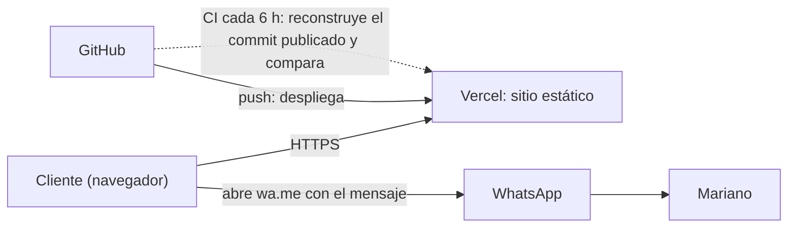
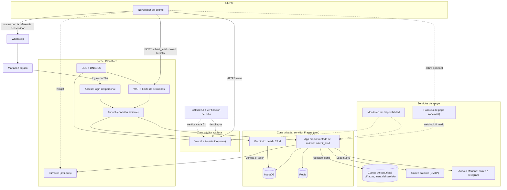

# Próximas integraciones y arquitectura objetivo

Qué se va a integrar después de lo que ya existe (Cloudflare, Frappe/CRM y lo que cuelga de ellos), en qué orden, cómo queda la arquitectura completa y **qué hay que conseguir** para llegar ahí. Es una hoja de ruta, no código: **nada de lo que sigue está implementado**.

Complementa a [SEGURIDAD.md](SEGURIDAD.md) (amenazas, controles y el contrato del endpoint) y a [ESPECIFICACION.md](ESPECIFICACION.md). Estado al 2026-11-20.

Las afirmaciones sobre servicios de terceros (planes gratuitos, límites, nombres de funciones, versiones) son orientativas y hay que **confirmarlas en la documentación vigente** antes de comprar o implementar. Se marcan con *(confirmar)*.

## 1. Principios

1. **WhatsApp sigue siendo el canal y el plan B.** El CRM suma registro, serial y seguimiento, pero si no responde el cliente igual envía su mensaje.
2. **El sitio público sigue siendo estático.** Mantiene la CSP por hash, el CDN y la superficie de ataque mínima.
3. **Ningún secreto en el navegador.** Los secretos viven en el servidor o en el gestor de secretos del proveedor, nunca en el repositorio ni en variables `NEXT_PUBLIC_*`.
4. **Lo público y lo administrativo no se mezclan.** El visitante nunca tiene sesión; el personal entra por una vía distinta y con doble factor.
5. **Nada se confía al navegador.** Todo lo que llegue al servidor se valida de nuevo contra el catálogo.
6. **Cada pieza se puede apagar sin romper las demás.** Si cae Frappe, el sitio funciona; si cae Cloudflare, el sitio funciona.

## 2. Arquitectura hoy

Sin servidor propio, sin base de datos, sin cookies. La referencia `ML-AAMMDD-XXXX` se genera en el navegador y es solo una etiqueta.

## 3. Arquitectura objetivo

### 3.1 Flujos y quién se autentica

| Flujo | Origen → destino | Autenticación | Datos |
|---|---|---|---|
| Ver el sitio | Navegador → Vercel | Ninguna (público) | Páginas estáticas |
| Registrar una consulta | Navegador → Cloudflare → Frappe | Ninguna, pero con token Turnstile, límite de peticiones y validación en el servidor. **Sin cookies** | Relevamiento, contacto, consentimiento |
| Enviar el mensaje | Navegador → WhatsApp | La propia app del cliente | Texto con la referencia |
| Trabajar los Leads | Personal → Cloudflare Access → Frappe | Identidad en Access **y** usuario con 2FA en Frappe | Todo el CRM |
| Despliegue | GitHub → Vercel | Integración de Vercel con el repositorio | Código |
| Vigilancia | GitHub Actions → sitio publicado | Ninguna (solo lectura pública) | Páginas y scripts |
| Copias de seguridad | Frappe → almacenamiento externo | Credencial dedicada de solo escritura | Base de datos y archivos cifrados |

### 3.2 Zonas de confianza

| Zona | Quién controla | Regla |
|---|---|---|
| Navegador del cliente | El cliente | No se confía en nada de lo que envía |
| Borde (Cloudflare) | Mariano, como cliente del servicio | Filtra y limita; no guarda datos del CRM |
| Vercel | Mariano | Solo contenido público, sin secretos |
| Servidor Frappe | Mariano | Único lugar con datos personales y secretos del lado servidor |
| Servicios de apoyo | Terceros | Con credenciales mínimas y rotables |

### 3.3 DNS propuesto

| Registro | Apunta a | Proxy de Cloudflare | Motivo |
|---|---|---|---|
| `tudominio.com` y `www` | Vercel | **No** (solo DNS) | Vercel ya trae su CDN y su cortafuegos; poner otro proxy delante suele duplicar funciones y complicar certificados *(confirmar)* |
| `crm.tudominio.com` | Tunnel de Cloudflare | **Sí** | Oculta el servidor, aplica WAF, límite de peticiones y Access |
| Registros de correo (SPF, DKIM, DMARC) | Proveedor SMTP | No | Para que las notificaciones lleguen y no se falsifique el dominio |
| `/.well-known/security.txt` | Archivo estático del sitio | — | Dónde reportar una vulnerabilidad |

Turnstile no exige que el sitio pase por el proxy de Cloudflare: solo una cuenta y la verificación del token en el servidor *(confirmar)*.

## 4. Integraciones, en orden

Cada una dice qué la bloquea y cuándo se considera hecha.

### I-1. Cuentas y dominio (requisito de todo lo demás)

- Dominio propio en un registrador con **bloqueo de transferencia**, 2FA y DNSSEC.
- Repositorio en GitHub, proyecto en Vercel y cuenta de Cloudflare, todos con 2FA por aplicación o llave física.
- Activar el CI y la verificación programada ([SEGURIDAD.md](SEGURIDAD.md), 5.7).
- Publicar `security.txt`.

**Hecho cuando:** el sitio responde en el dominio propio con HTTPS, `verify-live.yml` pasa a mano y todas las cuentas tienen 2FA.

### I-2. Cloudflare

Qué se configura:
- **DNS y DNSSEC** del dominio (si se delega el DNS en Cloudflare).
- **Tunnel** (`cloudflared`) en el servidor de Frappe: la conexión es saliente, así que el servidor no necesita puertos de entrada abiertos *(confirmar la versión del cliente)*.
- **WAF y reglas de acceso para `crm.tudominio.com`:**
  1. Se permite desde cualquier lugar **solo** `POST` y `OPTIONS` a la ruta del método de invitado.
  2. Todo lo demás (escritorio, `/api/resource`, `/login`, otros métodos) exige **Access**.
  3. Límite de peticiones por IP sobre la ruta pública.
  4. Opciones contra bots activadas.
- **Access** con política de identidad para el personal (correo + proveedor de identidad), complementado por el 2FA del propio Frappe.
- **Turnstile**: un widget para el sitio (clave pública) y una clave secreta que se guarda solo en el servidor.

Cambios en este repositorio *(hoy solo existe `CSP_CONNECT_SRC`)*:

| Qué habilita | Cambio en la CSP |
|---|---|
| Llamar a Frappe | `connect-src` con `https://crm.tudominio.com` → variable `CSP_CONNECT_SRC` (ya existe) |
| Mostrar Turnstile | `script-src` y `frame-src` con `https://challenges.cloudflare.com`; hay que agregar opciones equivalentes a `CSP_CONNECT_SRC` en `scripts/harden-build.mjs` |

Ese script de Turnstile **no puede llevar SRI** (el proveedor lo actualiza). Es una concesión consciente: se acota con el origen exacto.

**Hecho cuando:** una petición pública a cualquier ruta distinta de la de invitado recibe una negativa, el escritorio solo abre tras Access, y el límite de peticiones corta una ráfaga de prueba.

### I-3. Servidor Frappe

**Dónde alojarlo**

| Opción | Ventajas | Desventajas |
|---|---|---|
| **Frappe Cloud** (alojamiento gestionado por los autores de Frappe) | Menos operación: actualizaciones, copias y monitoreo vienen resueltos | Menos control del sistema; hay que verificar que permita una app propia y el Tunnel *(confirmar)*; costo recurrente |
| **Servidor propio** (VPS o dedicado) | Control total; se integra con Tunnel sin puertos de entrada | Toda la operación es tuya: parches, copias, monitoreo, respuesta a incidentes |

Para una persona que atiende el negocio y no es administradora de sistemas, **Frappe Cloud o un proveedor que gestione el servidor** reduce el riesgo operativo; el servidor propio solo conviene si hay quien lo mantenga.

**Qué se instala:** Frappe en su versión estable vigente *(confirmar)*, con la app de CRM elegida (Frappe CRM o el módulo CRM de ERPNext; verificar qué DocType usa para el contacto inicial: `CRM Lead` o `Lead`), MariaDB, Redis, nginx y supervisor. Tamaño orientativo para un CRM chico: 2 vCPU, 4 GB de RAM y 40 GB de disco como mínimo *(confirmar con la documentación de la versión elegida)*.

**Qué se construye:** una **app propia** (por ejemplo `landing_intake`) con:
- el método `submit_lead` de invitado (contrato en [SEGURIDAD.md](SEGURIDAD.md), 7.5);
- campos propios en el Lead: `reference`, `form_version`, `language`, `source`, `offer`, `consent` con fecha;
- una **serie de nombres** para el serial (por ejemplo `ML-.YY.MM.DD.-.####`);
- tabla hija o campo para servicios de interés y el texto del relevamiento;
- validación completa contra el catálogo, idempotencia y respuesta mínima.

**Endurecimiento del servidor:** acceso SSH solo con llaves y sin contraseña, cortafuegos que solo admita el Tunnel (o Cloudflare), actualizaciones de seguridad automáticas, usuario del sistema sin privilegios, 2FA obligatoria para el personal, desactivar el registro de usuarios, registros y alertas.

**Copias de seguridad:** diarias, cifradas, **fuera del servidor**, con una prueba de restauración periódica. Una copia que nunca se restauró no es una copia.

**Hecho cuando:** `submit_lead` crea un Lead con serial correcto desde una petición válida, rechaza las inválidas, deduplica un reintento y se restaura una copia en un entorno de prueba.

### I-4. Integración del front

Cambios previstos en este repositorio:

| Dónde | Cambio |
|---|---|
| `src/controller/` | Llamada al endpoint con tiempo límite (~4 s), clave de idempotencia, estado "enviando" y **respaldo a WhatsApp** si falla |
| `src/model/message.ts` | `REFERENCE_PATTERN` e `isValidReference` aceptan el formato del servidor (los dígitos 0 y 1 hoy están excluidos); una forma distinguible para la referencia local de respaldo |
| `src/controller/resume.ts` | La misma condición de referencia válida (una prueba exige que coincida con `sanitize`) |
| `src/view/survey/` | Casilla de consentimiento, widget de Turnstile, mensajes de error en los tres idiomas |
| `src/model/i18n.ts` | Textos nuevos, y la frase de privacidad del pie **deja de ser cierta**: debe reescribirse |
| `src/model/message.ts` | Subir `SURVEY_VERSION`; el pie del mensaje puede indicar que la consulta quedó registrada |
| CSP | Las variables de I-2 |
| Pruebas | Respuesta exitosa, tiempo agotado, rechazo del servidor, reintento sin duplicar, y que el respaldo a WhatsApp nunca se rompa |

**Hecho cuando:** un cliente completa el relevamiento, recibe la referencia del servidor, el Lead aparece en el CRM y WhatsApp abre con esa referencia; y con Frappe apagado el cliente igual puede enviar su mensaje.

### I-5. Flujo de trabajo de Mariano

- Aviso cuando entra un Lead nuevo (correo y, si se quiere, Telegram) con el resumen y el enlace.
- Estados del embudo (nuevo → contactado → reunión → propuesta → cerrado), recordatorios de seguimiento y asignación.
- Conversión de Lead a Customer cuando hay relación comercial.
- Tablero del origen (`tarjeta`, enlace, etc.) para medir qué canal trae consultas.
- *(Opcional)* WhatsApp Business API para responder desde el CRM: requiere aprobación de Meta, plantillas y costos por conversación *(confirmar)*; no es necesario para empezar.

**Hecho cuando:** un Lead de prueba recorre todos los estados y dispara los avisos.

### I-6. Cobro y agenda (opcional)

- Una pasarela de pago acorde al país y la moneda (por ejemplo Mercado Pago, Stripe o PayPal; elegir con quien cobra). El **identificador de la operación lo emite la pasarela**, y llega a Frappe por un webhook firmado: nunca se acepta del navegador.
- Calcular el total desde el servidor con la misma regla que hoy usa el sitio (bloques de 10 minutos, `meetingCost`), para que el cliente no pueda alterar el importe.
- Agenda de la reunión: un servicio de reservas o el módulo de citas de Frappe *(confirmar)*.

**Hecho cuando:** un pago de prueba queda asociado al Lead, y un importe alterado en el navegador es ignorado por el servidor.

### I-7. Operación y observabilidad

- Monitoreo de disponibilidad del sitio y del endpoint, con alertas.
- Registros centralizados y revisión periódica.
- Plan de respuesta a incidentes: quién revisa la alerta de `verify-live.yml`, cómo se restaura un despliegue, cómo se rota una credencial.
- Revisión trimestral de usuarios, accesos, dependencias y copias.

## 5. Qué hay que conseguir

| # | Qué | Para qué | Lo necesita | Notas |
|---|---|---|---|---|
| 1 | **Dominio propio** | Sitio, QR de la tarjeta, correo, CRM | I-1 | Registrador con bloqueo de transferencia y DNSSEC. Hoy el sitio usa un dominio provisorio |
| 2 | Repositorio en GitHub | CI, Dependabot, verificación | I-1 | Subir el código y activar los flujos (SEGURIDAD.md, 5.7) |
| 3 | Proyecto en Vercel con el dominio | Publicar el sitio | I-1 | Variables `NEXT_PUBLIC_SITE_URL` y versión de Node igualadas al CI |
| 4 | **Cuenta de Cloudflare** | DNS, WAF, Turnstile, Access, Tunnel | I-2 | Confirmar qué incluye el plan gratuito y si alcanza *(confirmar)* |
| 5 | **Servidor de Frappe** o plan en Frappe Cloud | Alojar el CRM | I-3 | Orientativo: 2 vCPU / 4 GB / 40 GB *(confirmar)*; cotizar según proveedor |
| 6 | Almacenamiento externo para copias | Backups cifrados fuera del servidor | I-3 | Cualquier almacenamiento compatible con S3 o similar |
| 7 | Correo saliente (SMTP) y registros SPF, DKIM, DMARC | Avisos de Leads y recuperación de cuentas | I-3, I-5 | Del mismo dominio |
| 8 | Gestor de contraseñas y de secretos | Guardar credenciales con acceso compartido controlado | Todas | Nada en el repositorio ni en chats |
| 9 | Llaves de seguridad o app de 2FA para cada persona | Doble factor | I-1, I-3 | Dos métodos por cuenta, para no perder el acceso |
| 10 | Textos legales: política de privacidad y consentimiento | Guardar datos personales | I-4 | Revisión de un profesional; ver SEGURIDAD.md, 7.7 |
| 11 | Servicio de monitoreo | Alertas de caída | I-7 | Gratuito o pago, según la frecuencia necesaria |
| 12 | Canal de avisos (correo, Telegram) | Notificar Leads y alertas de seguridad | I-5, I-7 | Definir quién recibe |
| 13 | *(Opcional)* Número de WhatsApp Business / API | Responder desde el CRM | I-5 | Proceso de aprobación de Meta *(confirmar)* |
| 14 | *(Opcional)* Pasarela de pago | Cobrar la consulta | I-6 | Según país, moneda y comisiones |
| 15 | *(Opcional)* Servicio de agenda | Reservar la reunión | I-6 | Puede ser el módulo de Frappe |
| 16 | Tarjeta e impresión con el QR final | Canal de entrada | I-1 | QR a `https://<dominio>/?o=tarjeta` |

## 6. Secretos y variables: dónde vive cada cosa

| Dato | Público | Dónde se guarda | Nunca en |
|---|---|---|---|
| Clave pública de Turnstile | Sí | Variable de build del sitio | — |
| **Clave secreta de Turnstile** | No | Configuración del sitio de Frappe | Repositorio, navegador |
| Token del Tunnel de Cloudflare | No | Servidor de Frappe | Repositorio |
| Credenciales de las copias | No | Servidor de Frappe | Repositorio |
| Credenciales SMTP | No | Frappe | Repositorio |
| Secreto de webhook del pago (I-6) | No | Frappe | Repositorio, navegador |
| `NEXT_PUBLIC_SITE_URL`, `CSP_CONNECT_SRC` | Sí | Vercel y variables del repositorio de GitHub (**iguales**) | — |
| Usuarios y 2FA del personal | No | Frappe y Access | — |

Regla: si un valor empieza con `NEXT_PUBLIC_` termina en el navegador de cualquiera.

## 7. Qué pasa cuando algo falla

| Se cae | Efecto | Por qué sigue funcionando lo esencial |
|---|---|---|
| Frappe | No se registra la consulta | El front abre WhatsApp igual con una referencia local marcada como "sin registro" |
| Cloudflare (borde del CRM) | Igual que arriba | Ídem. El sitio en Vercel no pasa por ahí |
| Vercel | El sitio no carga | El número de WhatsApp está en la tarjeta; la emergencia sigue siendo un mensaje directo |
| Turnstile | No se pueden enviar consultas al CRM | Respaldo a WhatsApp |
| El almacenamiento de copias | Sin copias nuevas | Alerta de monitoreo; el CRM sigue funcionando |

## 8. Riesgos de integrar

| Riesgo | Mitigación |
|---|---|
| Se guardan datos personales sin base legal | Consentimiento, política y retención definidos **antes** de activar el CRM (SEGURIDAD.md, 7.7) |
| El endpoint público se usa para spam | Turnstile, límite de peticiones, honeypot, idempotencia, validación completa |
| Se pierden datos por falta de copias | Copias cifradas fuera del servidor y pruebas de restauración |
| El servidor se vuelve una carga de mantenimiento | Preferir un servicio gestionado; documentar el procedimiento de parches |
| La CSP se afloja con cada integración | Un origen por vez, exacto; el verificador falla ante `unsafe-inline` o comodines |
| El front depende del CRM | Respaldo a WhatsApp con prueba automática |
| Una credencial se filtra | Secretos fuera del repositorio, rotación, alcances mínimos |

## 9. Orden recomendado y cuándo disparar cada paso

1. **I-1** ya, sin esperar decisiones: es prerrequisito y no cuesta más que tiempo.
2. **I-2 parcial** (DNS, DNSSEC y Turnstile) cuando se decida avanzar con el CRM.
3. **I-3 e I-4 juntas**, en un entorno de prueba antes de producción.
4. **I-5** cuando entren las primeras consultas reales al CRM.
5. **I-6** solo si se decide cobrar la consulta.
6. **I-7** desde I-3, no al final.

Criterio para empezar con el CRM: que haga falta seguimiento, un serial real o cobro, o que el volumen supere lo que se maneja cómodo desde el chat de WhatsApp (ver SEGURIDAD.md, 7.1).

## 10. Decisiones abiertas

1. ¿Frappe Cloud (gestionado) o servidor propio?
2. ¿Frappe CRM (app) o el módulo CRM de ERPNext?
3. Una o dos direcciones para el CRM: una sola (`crm.`) con reglas por ruta, o separar la entrada pública (`intake.`) del escritorio. Dos aíslan mejor pero exigen mapear ambos nombres al mismo sitio de Frappe y revisar cookies y CORS *(confirmar)*.
4. ¿Se cobra la consulta, y con qué pasarela?
5. ¿Se usa WhatsApp Business API o alcanza con el WhatsApp actual?
6. Quién recibe las alertas y quién tiene acceso al servidor.
